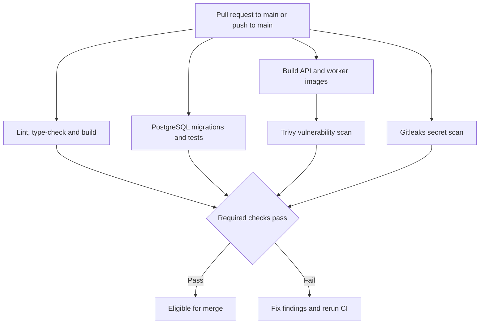
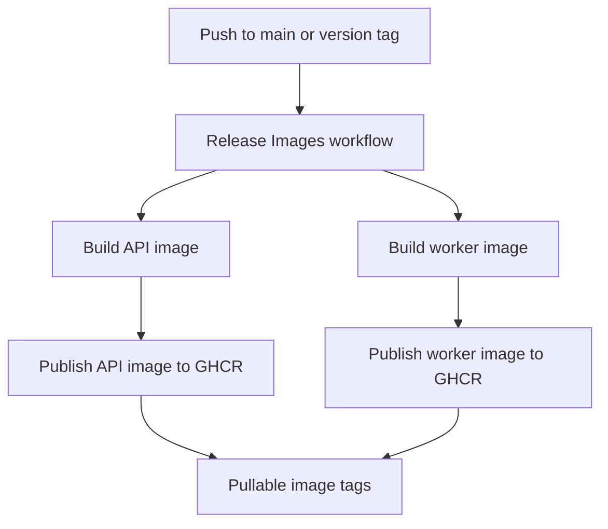

# Beacon Architecture

## Overview

Beacon is a containerized monitoring platform with an API, a background worker, and PostgreSQL. GitHub Actions provides continuous integration, container security scanning, and container image publishing.

This document describes the CI/CD architecture and the security controls used to build and release Beacon.

## CI/CD Architecture

### Continuous Integration

The `CI` workflow (`.github/workflows/ci.yml`) runs on:

- Pull requests targeting `main`
- Pushes to `main`

The workflow contains four jobs:

| Job                                 | Responsibilities                                                                         |
| ----------------------------------- | ---------------------------------------------------------------------------------------- |
| Lint, type-check and build          | Install npm dependencies, run linting, type-check packages, and build the API and worker |
| Database migration and worker tests | Start PostgreSQL, apply migrations, and run tests                                        |
| Docker image build and scan         | Build the API and worker images and scan them with Trivy                                 |
| Gitleaks secret scan                | Scan the repository's full Git history for exposed secrets                               |

The npm dependency audit is informational and does not fail the workflow on its own.

### CI Flow



## Container Images

Beacon builds separate Docker images for:

- API: `apps/api/Dockerfile`
- Worker: `apps/worker/Dockerfile`

The CI workflow builds both images without publishing them. It uses Docker Buildx and GitHub Actions cache to reduce repeated build time.

The runtime images use multi-stage Docker builds to separate compilation from runtime execution. Containers run as a non-root user, and unnecessary tooling is removed from the runtime image where applicable.

## Security Scanning

### Trivy

Trivy scans both built container images for operating-system and library vulnerabilities.

The CI scan targets HIGH and CRITICAL findings and ignores vulnerabilities for which no fix is available. Fixable findings at the configured severity levels fail the scan.

### Gitleaks

Gitleaks scans the full Git history for secrets. The workflow checks out the repository with full history so that previously committed secrets can also be detected.

### Dependency Audit

The CI workflow runs `npm audit --omit=dev` as an informational check. Its result is not currently a blocking CI requirement.

## Container Image Publishing

The release workflow (`.github/workflows/release.yml`) publishes API and worker images to GitHub Container Registry (GHCR).

It runs on:

- Pushes to `main`
- Version tags matching `v*`

Each image receives a commit-specific tag:

```text
sha-<short-commit>
```

For strict three-part semantic version tags such as `v0.4.0`, the workflow also publishes:

```text
<major>.<minor>.<patch>
<major>.<minor>
```

For example, a release tagged `v0.4.0` produces `0.4.0` and `0.4` image tags in addition to the commit-specific tag.

The workflow does not publish a mutable `latest` tag.

Published image names follow this pattern:

```text
ghcr.io/<owner>/<repository>/beacon-api:<tag>
ghcr.io/<owner>/<repository>/beacon-worker:<tag>
```

Package visibility is configured separately in GHCR settings.

### Release Flow



## GitHub Actions Security

### Action Pinning

Third-party GitHub Actions are pinned to full commit SHAs rather than mutable version tags. Version comments are retained for readability and maintenance.

Dependabot is configured to propose updates for npm dependencies, Docker base images, and GitHub Actions.

### Least-Privilege Permissions

Workflow permissions are explicitly declared.

- CI uses read-only repository contents permissions.
- The release workflow grants package-write permission only to the publishing job.
- The release workflow uses `GITHUB_TOKEN` to authenticate with GHCR.

### Branch Protection

The `main` branch requires pull requests and passing CI checks. Linear history is enforced, and force pushes and branch deletion are restricted.

## Local CI

The Makefile provides a `make ci` target for local validation before pushing changes.

The target runs dependency installation, linting, type-checking, application builds, and the existing test suite.

Local CI does not replace all GitHub Actions checks. PostgreSQL integration setup, Trivy image scanning, and Gitleaks scanning remain part of the hosted workflow.

## Architecture Decisions

### GitHub Actions

GitHub Actions is used for CI/CD because the repository is hosted on GitHub and the workflows integrate directly with pull requests, branch protection, and GHCR.

### Separate API and Worker Images

The API and worker are built and published as separate images. This keeps their deployment artifacts independent while allowing them to share workspace packages during compilation.

### Immutable Image Identification

Commit-specific image tags provide a direct reference to the source revision used for a build. Semantic version tags provide convenient release identifiers. The workflow intentionally avoids a mutable `latest` tag.

## Workflow Files

| File                            | Purpose                                                                |
| ------------------------------- | ---------------------------------------------------------------------- |
| `.github/workflows/ci.yml`      | Linting, type-checking, builds, migrations, tests, Trivy, and Gitleaks |
| `.github/workflows/release.yml` | Publish API and worker images to GHCR                                  |
| `.github/dependabot.yml`        | Automated dependency update PRs                                        |
| `Makefile`                      | Local development and CI commands                                      |

## Maintenance

When changing the CI/CD architecture:

1. Update the affected workflow.
2. Run `make ci` where applicable.
3. Verify the required GitHub Actions checks.
4. Update this document when workflow behavior or security decisions change.
